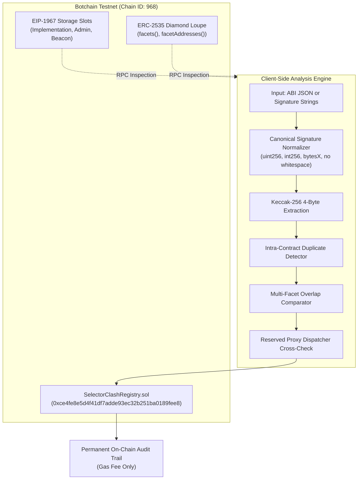

# SelectorClash: Algorithmic Function Selector Collision Detection & On-Chain Verification Registry for Modular and Upgradeable EVM Architectures

**Whitepaper v1.0.0**  
**Network:** Botchain Testnet (Chain ID: 968)  
**Deployed Smart Contract:** [`0xce4fe8e5d4f41df7adde93ec32b251ba0189fee8`](https://scan.bohr.life/address/0xce4fe8e5d4f41df7adde93ec32b251ba0189fee8)  
**Native Currency:** BOT (Gas Fee Only Architecture)  
**Repository:** [https://github.com/webtrovert0x/selectorClash](https://github.com/webtrovert0x/selectorClash)  

---

## 1. Abstract

In Ethereum Virtual Machine (EVM) execution environments, function dispatching relies on a 4-byte (32-bit) identifier derived from the cryptographic hash of a function's canonical signature: `bytes4(keccak256("functionName(paramTypes...)"))`. While this truncation offers calldata efficiency, it restricts the unique selector entropy space to exactly $2^{32} = 4,294,967,296$ possible values. Consequently, distinct function signatures can—and frequently do—produce identical 4-byte identifiers, an occurrence known as a **Function Selector Collision**.

In monolithic Solidity contracts, the compiler prohibits duplicate internal selectors. However, in contemporary modular systems—such as **ERC-1967 Transparent & UUPS Proxies** and **ERC-2535 Diamond Multi-Facet Architectures**—function dispatching is bifurcated or decoupled across separate contracts. This structural separation creates a critical vulnerability: an implementation function can intentionally or accidentally shadow a proxy admin function (the "Tincho attack vector"), or two facets can collide, leading to unexpected transaction hijacking, state corruption, or privilege escalation.

**SelectorClash** is a comprehensive, production-grade security suite and decentralized registry deployed on **Botchain Testnet (Chain ID: 968)**. It provides pre-deployment canonical ABI selector extraction, cross-facet collision verification, on-chain ERC-1967 storage slot inspection, ERC-2535 Diamond Loupe validation, and an immutable decentralized registry (`SelectorClashRegistry.sol`) operating strictly under a **Gas Fee Only** model with zero protocol surcharges.

---

## 2. EVM Function Dispatch Paradigm & Mathematical Analysis

### 2.1 The 4-Byte Calldata Dispatch Mechanism
When a transaction executes against an EVM smart contract, the contract's runtime bytecode examines the initial four bytes of `msg.data` (the calldata):

$$\text{Selector} = \text{First 4 bytes of } \operatorname{Keccak256}(\text{CanonicalSignature})$$

$$\text{Calldata} = \underbrace{\text{0x}\dots\dots\dots\dots}_{\text{4-byte selector}} \parallel \underbrace{\text{arg}_1 \parallel \text{arg}_2 \parallel \dots}_{\text{ABI-encoded arguments}}$$

Inside the contract's dispatcher, a series of jump instructions compare this 4-byte prefix:

```text
PUSH4 selector
EQ
JUMPI destination
```

### 2.2 Entropy Space & The Birthday Paradox
Truncating a 256-bit cryptographic hash to 32 bits discards 224 bits of entropy. The total number of unique selectors is:

$$N = 2^{32} = 4,294,967,296$$

According to the Birthday Paradox, given an entropy space of size $N$, the probability $P(k)$ that at least one collision exists among a collection of $k$ randomly chosen function signatures is approximated by:

$$P(k) \approx 1 - e^{-\frac{k(k - 1)}{2N}} \approx 1 - e^{-\frac{k^2}{2 \times 2^{32}}}$$

| Number of Functions ($k$) | Approximate Collision Probability |
|:---------------------------|:-----------------------------------|
| 10                         | $0.00000105\%$ ($1.05 \times 10^{-8}$) |
| 50                         | $0.0000285\%$ ($2.85 \times 10^{-7}$) |
| 100                        | $0.000116\%$ ($1.16 \times 10^{-6}$) |
| 1,000                      | $0.0116\%$ ($1.16 \times 10^{-4}$) |
| 5,000                      | $0.2905\%$ ($2.91 \times 10^{-3}$) |
| 10,000                     | $1.157\%$ ($1.16 \times 10^{-2}$) |
| 77,163                     | **$50.0\%$ (Expected Birthday Bound)** |

While $77,163$ signatures are required for a 50% arbitrary collision probability, **targeted collision mining** (finding an alternate signature $f'$ that clashes with a specific high-value signature $f$) requires only $\sim 2^{32} \approx 4.29 \times 10^9$ hashes. On standard modern consumer hardware, $4.29 \times 10^9$ Keccak-256 operations can be computed in under 30 seconds using GPU-accelerated hashing pipelines.

---

## 3. Threat Vectors & Attack Surfaces

### 3.1 Transparent Proxy Admin Interception (The Tincho Vector)
In the OpenZeppelin ERC-1967 Transparent Proxy pattern, `fallback()` delegates execution based on caller privilege:

```solidity
if (msg.sender == proxyAdmin) {
    // Execute proxy administrative logic (upgradeTo, changeAdmin, etc.)
} else {
    // Delegatecall to implementation contract
    _delegate(implementation);
}
```

#### The Vulnerability:
If a malicious or unverified implementation contract includes a public function whose 4-byte selector matches an administrative function:
1. **Admin Clashing**: If the proxy admin calls this function expecting to execute implementation logic, the proxy intercepts the call and executes administrative logic instead.
2. **User Denial-of-Service / Hijacking**: If an administrative function selector is shadowed in the implementation, user transactions intended for the implementation function will fail or behave unpredictably whenever invoked by accounts with administrative rights.
3. **Historical Exploitation**: In 2021, security researcher Tincho discovered that signatures such as `clash550254402()` share the exact selector `0x025313a2` with `proxy_owner()`. Any implementation deploying `clash550254402()` introduces severe routing ambiguities.

### 3.2 ERC-2535 Diamond Multi-Facet Shadowing
The ERC-2535 Diamond Standard modularizes contract logic into separate facet contracts managed by a central proxy:

$$\operatorname{Router}: \text{mapping}(\text{bytes4} \implies \text{FacetAddressAndPosition})$$

Because each facet contract is compiled in isolation by the Solidity compiler:
- Solidity's internal collision check is blind to function signatures in other facets.
- When `diamondCut` is executed to register facet functions, if Facet $B$ introduces a selector already present in Facet $A$, without strict off-chain or on-chain loupe validation, Facet $B$ silently overwrites Facet $A$'s routing slot.
- Users executing transactions intended for Facet $A$ are silently routed to Facet $B$, leading to silent logic replacement, unauthorized fund drainage, or broken state variables.

---

## 4. The SelectorClash Solution

SelectorClash provides a three-layer defense matrix:
1. **Pre-deployment Canonical Analysis Engine** (Client-side).
2. **On-chain State Inspector** for Botchain Testnet (EIP-1967 and ERC-2535).
3. **Decentralized Verification & Audit Registry** (`SelectorClashRegistry.sol`).



### 4.1 Canonical Signature Normalization
Solidity allows aliases in function declarations (e.g., `uint` for `uint256`, `int` for `int256`, `byte` for `bytes1`). A naive string hash will produce an incorrect selector if types are not properly canonicalized.

SelectorClash enforces the strict EIP-712 / ABI canonical specification:
- Strips parameter names, return types, memory/calldata/storage qualifiers, and whitespace.
- Normalizes all elementary aliases (`uint` $\implies$ `uint256`, `int` $\implies$ `int256`, `byte` $\implies$ `bytes1`).
- Recursively decomposes complex tuple and array parameters (e.g. `(uint,address[])` $\implies$ `(uint256,address[])`).
- Computes canonical `bytes4(keccak256(canonicalString))`.

### 4.2 On-Chain Storage Slot & Loupe Inspection
For contracts already deployed on **Botchain Testnet**, SelectorClash performs direct RPC queries (`https://rpc.bohr.life`):
- **EIP-1967 Implementation Slot**: `0x360894a13ba1a3210667c828492db98dca3e2076cc3735a920a3ca505d382bbc`
- **EIP-1967 Admin Slot**: `0xb53127684a568b3173ae13b9f8a6016e243e63b6e8ee1178d6a717850b5d6103`
- **EIP-1967 Beacon Slot**: `0xa3f0ad74e5423aebfd80d3ef4346578335a9a72aeaee59ff6cb3582b35133d50`
- **ERC-2535 Diamond Loupe**: Calls `facets()` on the target address to reconstruct the live selector-to-facet routing matrix and report active collisions.

### 4.3 Decentralized Registry (`SelectorClashRegistry.sol`)
The on-chain smart contract is deployed on Botchain Testnet at address [`0xce4fe8e5d4f41df7adde93ec32b251ba0189fee8`](https://scan.bohr.life/address/0xce4fe8e5d4f41df7adde93ec32b251ba0189fee8).

#### Key Functions:
```solidity
function recordAudit(
    address targetContract,
    bytes32 abiHash,
    ArchitectureType archType,
    bool hasCollision,
    uint256 totalSelectors,
    bytes4[] calldata collidingSelectors,
    string calldata details
) external;

function reportCollision(
    address targetContract,
    bytes4 selector,
    string calldata signatureA,
    string calldata signatureB,
    CollisionCategory category,
    string calldata impactNotes
) external;

function getRecentAudits(uint256 limit) external view returns (AuditRecord[] memory);
function getRecentReports(uint256 limit) external view returns (CollisionReport[] memory);
```

---

## 5. Economic Policy: Strict Gas Fee Only Architecture

SelectorClash is designed as public-good security infrastructure:
1. **Zero Protocol Fees**: All contract functions are non-payable (`msg.value == 0`). No protocol surcharges, developer cuts, or subscription models exist.
2. **Network Gas Fee in Native Token (`BOT`)**: Transactions consume only the bare minimum EVM gas required for state updates on Botchain Testnet.
3. **No Hidden Paywalls**: Analysis, multi-facet comparisons, and database lookups run client-side for maximum speed and zero cost.

---

## 6. Technical Specifications

| Parameter | Specification |
|:---|:---|
| **Target Blockchain** | Botchain Testnet (Bohr) |
| **Chain ID** | `968` |
| **RPC Endpoint** | `https://rpc.bohr.life` |
| **Block Explorer** | `https://scan.bohr.life` |
| **Native Token** | `BOT` (18 decimals) |
| **Registry Contract** | `0xce4fe8e5d4f41df7adde93ec32b251ba0189fee8` |
| **Solidity Compiler** | `0.8.24` (EVM target: `cancun`) |
| **Frontend Framework** | Next.js 14 App Router, React 18, TypeScript |
| **Web3 Layer** | Viem v2, Wagmi v2, Reown AppKit (@reown/appkit-adapter-wagmi) |
| **Styling** | Tailwind CSS (Strict Neutral Black & Gray Palette) |

---

## 7. Security Considerations

- **Private Key Security**: Deployment and administrative credentials are never committed, bundled, or exposed to client browsers.
- **Client-Side Privacy**: ABI parsing, selector computation, and diff analysis happen within the user's browser runtime; sensitive unreleased contract ABIs are never sent to external centralized servers.
- **EVM Immutability**: Audits recorded on `SelectorClashRegistry.sol` are timestamped and cryptographically linked to the submitter's address, providing an auditable on-chain paper trail.

---

## 8. Conclusion

As smart contract ecosystems evolve from monolithic codebases toward modular, upgradeable proxy and diamond systems, the 4-byte function selector collision vector transitions from a mathematical curiosity into a severe threat. **SelectorClash** eliminates this attack surface by unifying pre-deployment algorithmic analysis, live on-chain storage and loupe inspection, and decentralized record-keeping on **Botchain Testnet**.

*Verified on Botchain Testnet • Gas Fee Only • Zero Protocol Fees*
